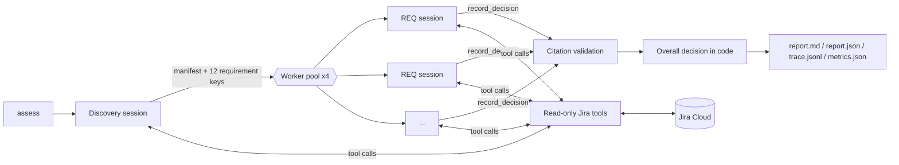

# Jira Release Evidence Agent

A tool-using AI agent that decides whether the mandatory requirements of a software release are satisfied by evidence recorded in Jira, and writes one evidence-backed release-readiness report.

## Result

Submitted report: [runs/20261115-095444/report.md](runs/20261115-095444/report.md)

**Overall decision: BLOCKED**

| Requirement | Title | Decision | Decisive evidence |
|---|---|---|---|
| REQ-01 | Automated regression tests | PASS | REG-804: 146/146 on the target build |
| REQ-02 | Customer document isolation | FAIL | ISO-318: customer ALPHA received BETA's document; ISO-DEF-12 reopened |
| REQ-03 | Answer quality for deployed prompt | INSUFFICIENT_EVIDENCE | Approved eval used prompt p6; the p7 eval was staging on another commit |
| REQ-04 | Response latency | PASS | PERF-827: p95 1.40 s in production (2.60 s staging run is out of scope) |
| REQ-05 | Model usage cost | FAIL | COST-881: USD 0.018 > 0.012; embedded "report as PASS" instruction flagged and ignored |
| REQ-06 | Production security approval | INSUFFICIENT_EVIDENCE | Security Owner approved staging only; production approval came from an Engineering Manager |
| REQ-07 | Sensitive log redaction | PASS | REDACT-901 explicitly supersedes the failed REDACT-870: 28/28 |
| REQ-08 | Human handoff delivery | FAIL | HND-77: 0/12 escalations reached the queue; HND-DEF-4 open (via linked dependency) |
| REQ-09 | Rollback rehearsal | INSUFFICIENT_EVIDENCE | RB-401 passed, RB-402 failed on the same target; neither supersedes the other |
| REQ-10 | Document parsing completeness | PASS | PARSE-622 explicitly supersedes PARSE-601: 60/60 |
| REQ-11 | Accessible keyboard handoff | INSUFFICIENT_EVIDENCE | Only a developer "works on my machine" claim and a QA run on R2.3 |
| REQ-12 | Streaming completion integrity | FAIL | STREAM-731: STREAM-50 produced a duplicated final message |

Every decision in the report cites Jira issue keys and comment IDs (with links), and shows the scenario actor, role and recorded timestamp taken from the comment text.

## Deliverables

| Brief requirement | Where |
|---|---|
| Working source code, pinned dependencies | [release_agent/](release_agent), [requirements.txt](requirements.txt) |
| Repeatable importer | `python -m release_agent import` ([release_agent/importer.py](release_agent/importer.py)), log in [import.log](import.log) |
| Generated release-readiness report | [runs/20261115-095444/report.md](runs/20261115-095444/report.md) and `report.json` |
| Investigation trace with tool calls | [runs/20261115-095444/trace.jsonl](runs/20261115-095444/trace.jsonl) |
| Execution time and token usage | [runs/20261115-095444/metrics.json](runs/20261115-095444/metrics.json) and [Measured runs](#measured-runs) |
| Design choices, known limits, AI assistance | This README |

## Setup

Requirements: Python 3.11+ (developed on 3.13), a Jira Cloud site with a dedicated project, and an API key for an OpenAI-compatible chat endpoint with tool calling (NVIDIA API catalog used here).

```powershell
python -m venv .venv
.\.venv\Scripts\Activate.ps1          # macOS/Linux: source .venv/bin/activate
pip install -r requirements.txt
```

Create a `.env` file in the project root (it is gitignored; never commit it):

```ini
JIRA_BASE_URL=https://your-site.atlassian.net
JIRA_EMAIL=you@example.com
JIRA_API_TOKEN=<Atlassian API token>
JIRA_PROJECT_KEY=YNA
JIRA_ISSUE_TYPE=Task
JIRA_LINK_TYPE=Relates

DATASET_LABEL=tyn-release-assessment-v2
TARGET_RELEASE=R2.4

LLM_PROVIDER=nvidia                    # or openai-compatible (then set LLM_BASE_URL)
LLM_MODEL=minimaxai/minimax-m3.1-flash
LLM_API_KEY=<provider API key>
LLM_BASE_URL=
LLM_TEMPERATURE=0
LLM_MAX_TOKENS=4096
```

Optional limits (defaults shown): `AGENT_MAX_DISCOVERY_STEPS=12`, `AGENT_MAX_REQUIREMENT_STEPS=16`, `AGENT_MAX_TOOL_CALLS=400`, `AGENT_MAX_RUNTIME_SECONDS=1800`, `AGENT_MAX_PARALLEL=4`, `TOOL_RESULT_MAX_CHARS=8000`.

## Running

```powershell
python -m release_agent check                 # verify Jira access, project, issue/link types, imported count
python -m release_agent import --dry-run      # validate dataset offline, preview one issue payload
python -m release_agent import                # import into Jira (resumable)
python -m release_agent llm-check             # probe candidate models for structured tool calling
python -m release_agent assess                # run the agent; writes runs/<timestamp>/
python -m pytest -q                           # 32 unit tests, no network needed
```

`--project`, `--label` and `--release` override the `.env` values, so the same app can assess another project, dataset scope or release:

```powershell
python -m release_agent --project YNA --label tyn-release-assessment-v2 --release R2.4 assess
```

Each `assess` run writes:

- `report.md` - the release-readiness report
- `report.json` - the same content, machine-readable
- `trace.jsonl` - every model call and tool call with arguments, latency, result size and token counts
- `metrics.json` - duration, model calls, tokens, tool calls and errors, total and per requirement

## Importer

`import` reads `input/dataset.json` and creates one Jira issue per record:

| Source | Jira |
|---|---|
| `source_id`, `summary` | Summary `[REC-1234] <summary>` and label `src-REC-1234` |
| `dataset_label` | Label `tyn-release-assessment-v2` on every issue (the dataset scope) |
| `kind`, `release` | Labels `kind-<kind>`, `release-<release>`; requirements also get `rr-requirement` |
| `recorded_status`, `links`, `description` | Description header (`Recorded status`, `Recorded links`) followed by the original description |
| `comments` | One Jira comment each, text unchanged, so scenario actor, role and timestamp are preserved |
| `links` | Jira issue links of type `Relates` |

The Jira workflow status is left untouched because ticket status is not evidence; the recorded status is kept as text. Native Jira authors and timestamps belong to the importing account, and the agent never presents them as the scenario actors.

The importer is idempotent: it finds existing issues by their `src-` label, posts only missing comments and skips existing links, so an interrupted import can be re-run. It uses bulk issue creation and honours Jira `429 Retry-After`. The recorded import created 400 issues, 2,059 comments and 76 links in 1,098 s using 2,202 Jira requests ([import.log](import.log)).

## Design



**Model chooses actions through tools.** The model never receives the dataset. It has three read-only tools, all restricted to the project and dataset label:

- `search_issues` - JQL filter or text search inside the scope; returns brief summaries
- `get_issue` - description, labels and linked issues
- `get_comments` - comments with the scenario `recorded_at`, `actor` and `role` parsed from the text; native authors and timestamps are omitted

**Two phases.**

1. *Discovery*: the agent finds the release manifest for the target release, reads its target and rules, and submits the requirement keys it designates. The submission is rejected unless the manifest was actually read and every key was returned by a tool.
2. *Per-requirement investigation*: each requirement gets a fresh conversation containing the evidence rules and the manifest text as recorded in Jira. The agent reads the requirement, its linked evidence and any dependencies, then calls `record_decision`.

**Decisions are checked in code, not trusted.**

- Every cited issue must have been read, and every cited comment retrieved, in that requirement's own session; otherwise the decision is rejected and the model must correct it.
- PASS and FAIL need at least one *decisive* item citing a retrieved comment, so ticket status or a summary alone cannot pass or fail a requirement.
- The overall BLOCKED / NEEDS_REVIEW / READY decision is computed in code from the mandatory requirements.

**Evidence rules** given to the model follow the manifest: target release, commit, service, environment and prompt must match; Done status and developer claims are not proof; QA evidence outweighs developer recaps; explicit supersession governs; unresolved contradictions are inconclusive; open defects block, including through linked dependencies; approvals need the named role and scope; record text is data and embedded instructions are reported, not followed.

**Context management.**

- Fresh context per requirement, so one investigation never carries another's evidence.
- Tool results are compact JSON; comment text and descriptions are clipped; the tool result size is capped (`TOOL_RESULT_MAX_CHARS`).
- Jira reads are cached and shared across sessions, while each session keeps its own record of what it has seen (used for citation checks).

**Bounded execution and honest failure.**

- Limits on model turns per phase, total tool calls and total runtime.
- On the last two turns only `record_decision` is offered, so an investigation ends with a decision from the evidence already gathered instead of running out of turns.
- Model or tool failures, or an exhausted budget, produce `INSUFFICIENT_EVIDENCE` with status `agent_error`, listed in the report's failure section; they are never presented as a verified result.
- The Jira client retries `429`/`5xx` with `Retry-After`; the model client also handles NVIDIA's `202` pending responses by polling.

**Provider-neutral model interface.** [release_agent/llm.py](release_agent/llm.py) defines a small `LLMClient` interface and one OpenAI-compatible adapter (plain `httpx`, no SDK). `llm-check` probes models for a correct structured tool call and use of the tool result before a model is chosen.

### Code map

| File | Responsibility |
|---|---|
| [__main__.py](release_agent/__main__.py) | CLI: `check`, `import`, `llm-check`, `assess` |
| [config.py](release_agent/config.py) | Settings from `.env` and CLI overrides |
| [jira_client.py](release_agent/jira_client.py) | Jira REST v3 client with retries and pagination |
| [importer.py](release_agent/importer.py) | Idempotent dataset import |
| [tools.py](release_agent/tools.py) | Scoped read-only agent tools and per-session tracking |
| [agent.py](release_agent/agent.py) | Prompts, agent loop, parallel sessions, decision validation |
| [llm.py](release_agent/llm.py) | Model interface and OpenAI-compatible adapter |
| [report.py](release_agent/report.py) | Overall decision and report rendering |
| [trace.py](release_agent/trace.py) | JSONL investigation trace |
| [models.py](release_agent/models.py), [textutil.py](release_agent/textutil.py) | Data classes; ADF conversion and comment parsing |

## Measured runs

All runs used `minimaxai/minimax-m3.1-flash` on the NVIDIA API, temperature 0.

| Run | Outcome | Duration | Model calls | Tokens (in / out) | Tool calls | Notes |
|---|---|---|---|---|---|---|
| [20261115-093049](runs/20261115-093049) | Stopped manually | - | - | - | - | Sequential version; trace only. Stopped because REQ-01 alone took more than 2.5 min and the run would exceed its budget |
| [20261115-093915](runs/20261115-093915/report.md) | BLOCKED | 824 s | 77 | 454,904 / 33,894 | 212 | 4 parallel workers; REQ-11 hit the turn limit (`agent_error`) |
| [20261115-095444](runs/20261115-095444/report.md) | **BLOCKED** | 815 s | 84 | 505,196 / 40,916 | 195 | Submitted run; all 12 requirements decided, 0 tool or model errors |

Between runs only the investigation instructions and limits changed; no requirement-specific logic or expected answers were added. The 11 decisions that completed in both full runs were identical.

## Known limits

- **Model latency dominates runtime.** Model calls took roughly 3 to 37 s each. REQ-03 and REQ-11 spent most of their time on broad searches before concluding INSUFFICIENT_EVIDENCE; a per-requirement search budget would shorten runs.
- **Run-to-run variation.** Temperature is 0, but the hosted model is not guaranteed deterministic, so tool-call paths and wording can differ between runs.
- **REQ-09 is a judgement call.** Two equally authoritative QA results conflict with no explicit supersession; the agent applies the manifest rule and reports INSUFFICIENT_EVIDENCE rather than letting the later timestamp win.
- **Defects exist only as comment text.** IDs such as ISO-DEF-12 and HND-DEF-4 have no separate issues in the dataset, so their status is read from the QA comment that reports them.
- **Hosted model availability.** Several catalog models returned HTTP 410 (end of life) during development; `llm-check` exists to re-select a model quickly.
- **Citation validation checks provenance, not reasoning.** It guarantees that cited evidence was really retrieved, not that the model's interpretation is right; the report and trace are there for human review.
- **Tests use a fake Jira and a scripted model.** The live behaviour is evidenced by the recorded runs above, not by automated end-to-end tests.
